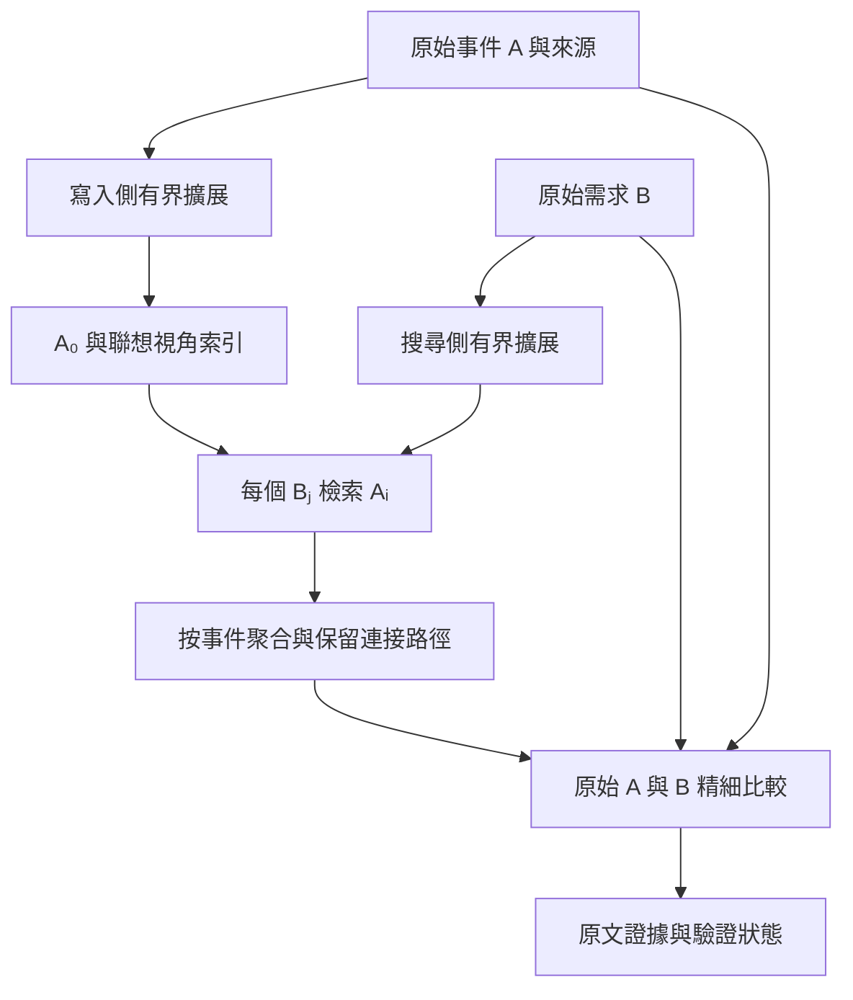

# 雙側聯想記憶系統設計

日期：2026-10-23。狀態：使用者已授權實作；M0–M2 基線已落地。本文件保留目標設計，實作範圍與尚未落地項目見 README。

## 1. 目標與邊界

把記憶檢索定義為：給定搜尋需求 B，在記憶庫找到能與 B 建立有效關係的原始事件 A。

使用者最初的描述以 A 表示搜尋目標、B 表示庫內事件，最後的寫入／搜尋要求交換了符號。本設計採最後定義：**寫入擴展 A，搜尋擴展 B**，兩側的角色保持固定。

要求如下：

1. 寫入時預先產生 A 的多種聯想視角；搜尋時產生 B 的多種檢索視角。
2. 在兩組視角之間尋找連接，並將命中還原至原始記憶。
3. 每個可返回的候選都必須經原始 A、B 的精細比較。
4. 原始事件永久作為證據基礎；生成的視角不得替代來源或直接回答問題。
5. 原文直達、僅寫入擴展、僅搜尋擴展、雙側擴展共用一套管線，以便消融比較。
6. 以候選上限、模型呼叫數、輸入量、索引體積與延遲共同約束成本。

首版服務保持 Add／Search 的同步使用方式；Search 返回記憶證據，不生成最終答案。使用獨立資料庫、設定命名空間及程序入口，避免將新舊演算法混在同一條流程。遷移必須由原始來源重建，不將舊摘要當成無條件可信的事實。

## 2. 形式化與架構

令 Eₛ(A)={A₀,A₁,…,Aₘ}，E_q(B)={B₀,B₁,…,Bₙ}。

粗召回尋找高分視角對 (Aᵢ,Bⱼ)，取得候選集合 C(B)。精判函數 V(A,B) 則獨立決定原始事件是否對原始需求有用。



邏輯上是所有 i、j 的比較，實作上讓 Bⱼ 查詢索引，不在每次搜尋對全庫計算 N×(m+1)×(n+1) 的笛卡兒積。索引以視角為節點、事件為返回單位。

聯想關係不具傳遞性：Aᵢ≈Bⱼ 不推出 A≈B。系統中的「找到」也不只指語義相似：原文可以是答案線索、約束、因果鏈的一段，或對問題前提的反證。

## 3. 原始事件與資料模型

### 3.1 原始事件的定義

A 是可以回到來源的事件記錄，不等於模型生成的摘要。對話可形成單則消息或包含必要相鄰語境的小事件；長文件按段落形成事件，保留標題、人物歸屬與必要前文。切分後必須能還原原文位置。

對「是的」「他後來改了」等片段，不可單獨視為完整事件；保存需要的上下文來源。事件的 normalized_text 只用於索引，精判讀取 source_spans 對應的原文。

### 3.2 邏輯表

| 表 | 主要欄位 | 用途與約束 |
|---|---|---|
| source | user_id, source_id, session_id, message_id, role, speaker_id, source_kind, content, timestamp, sensitivity | 保存原文；角色與人物不可由查詢覆蓋 |
| event | user_id, event_id, version, source_spans, normalized_text, subject, predicate, object, polarity, modality, event_time, valid_from/to, status, revision | 原始事件及有效性；不確定欄位允許 unknown |
| view | user_id, view_id, event_id, event_version, kind, text, anchor_spans, derivation, generator_version, embedding_space_id, status | 每個視角必須屬於事件版本；view 0 是原文視角 |
| view_vector | user_id, view_id, embedding_space_id, vector | 不同 embedding 空間不得混合比較 |
| relation | user_id, relation_id, from_event, predicate, to_event_or_entity, source_spans, provenance_type | 區分來源明述的關係與生成的聯想 |
| write_request | user_id, request_id, payload_hash, revision, state | 同 payload 重送冪等；同 ID 不同 payload 回傳衝突 |
| search_trace | user_id, search_id, revision, query_views, candidate_paths, decisions, budgets, degradation | 可選診斷資料；遵循來源權限與保留期限 |

實體主鍵／外鍵必須帶 user_id，所有索引查詢先做租戶與可見性限制。SQL、全文、向量及圖索引都不能先全庫 top-k 再過濾使用者。

時間分開記錄「事件發生時間」「來源陳述時間」「事實有效區間」。一個今天寫入的過去事件不能覆蓋今天仍有效的偏好。歷史搜尋依 as_of／include_history 選擇版本，不能單靠新舊排序代替時間判斷。

### 3.3 視角種類

| kind | A 的寫入視角 | B 的搜尋視角 |
|---|---|---|
| original | 原文及必要上下文 | 原始問題與明確條件 |
| paraphrase | 忠實改寫、別名、必要翻譯 | 同義問法、跨語言表述 |
| relation | 主體—關係—客體，保留否定和條件 | 待查關係與已知主體，未知值保留空槽 |
| abstraction | 由具體事件得到的上位概念 | 將具體要求抽象成可檢索的限制或目的 |
| applicability | 這則記憶可能在哪些需求中有用 | 需要哪種記憶才能處理此需求 |

首版每個 A 最多 4 個衍生視角，每個 B 最多 3 個；原文額外保留。這些是待調校的起始預算，不是最佳值。允許生成少於上限或零個，禁止為填滿數量編造資訊。

每個衍生視角有 anchor_spans 與 derivation：faithful 或 associative。faithful 要忠實於原文；associative 只表示檢索用途。例如「對蝦過敏」可以連到「海鮮餐點的飲食限制」，但後者不能寫成「對所有海鮮過敏」。來源錨點證明視角來自哪裡，不證明抽象推論一定成立。

## 4. 寫入 A：擴展、保存、建索引

1. 校驗請求、使用者、消息識別與冪等鍵。
2. 保存或暫存原始消息，產生有來源範圍的事件；保留否定、條件、人物、角色、時間與引述狀態。
3. 對每個事件做一次有界擴展，輸出上述視角與來源錨點。可批次處理，但總輸入與每個事件的輸出均有限制。
4. 校驗 anchor_spans 必須存在、未越界且引用一致；移除空白、完全重複、超長及無錨點視角。語義近重複按同 kind 的向量相似度去重，不能只因向量相近而合併否定或不同人物事件。
5. 批次嵌入 A₀ 與有效視角，寫入向量、全文與必要的有來源關係索引。
6. 在同一可見 revision 發布事件與索引；只有可被 Search 讀取才回傳成功。

語義擴展失敗時可僅提交 A₀，記錄 expansion_status=failed 與可重建工作；若原文必要索引也無法建立，Add 不得聲稱完整成功。模型失敗不得默默使用 hash embedding 寫入正式空間。

SQLite 原型可用單一交易提交原文與向量。外部向量庫版本使用 outbox＋pending／ready 狀態：只有 ready 的 revision 可見，Search 的 min_revision 提供讀己之寫語義。外部服務失敗必須能安全重試，不能以先寫資料庫就算成功。

重建聯想只替換衍生資料，不修改原始證據。embedding_space_id 包含模型、維度與預處理版本；換模型需建立新索引後切換，不能混查。

## 5. 搜尋 B：以資訊需求擴展

一次模型呼叫輸出 B 的必要條件、子需求與最多 3 個視角。每個視角保留對應 query facet，避免生成三句同義句卻漏掉另一項需求。

例：B「聚餐有蝦餃，替我安排時需要注意什麼？」

- B₀：原始問題。
- B₁（relation）：使用者對蝦或相關食材的過敏紀錄。
- B₂（applicability）：聚餐食物選擇需要遵守的個人飲食限制。
- B₃（paraphrase，可省略）：既有記憶中關於蝦餃食材與使用者飲食的注意事項。

B₁ 是待查需求，不是「使用者對蝦過敏」的斷言。選擇題的 options 只能產生待核對前提，不得將選項寫入事實庫或生成假想答案作為證據。

擴展不跨使用者注入個人畫像；未知人物、時間、因果不補猜。相對時間使用明確 reference_time，缺失時採介面規定的會話參考時間並記錄來源。擴展失敗則使用 B₀ 繼續，標記降級。

## 6. 召回：在兩側視角之間建立連接

### 6.1 路徑與起始預算

| 路徑 | 比較 | 起始候選預算 |
|---|---|---|
| 原文直達 | B₀ 對 A₀ 的向量與全文 | 最多 24 個事件 |
| 雙側聯想 | 每個 Bⱼ 對全部可見 Aᵢ | 每個視角每路最多 24 個事件 |
| 關係路徑（第二階段） | 有來源的實體／關係匹配 | 最多 12 個事件，最多一跳 |
| 合併後候選 | 所有路徑按 event_id/version 聚合 | 最多 64 個事件 |
| 精判 | 粗排後候選與原始 B | 最多 16 個事件 |

路徑預算按不同事件計數；同事件的多個視角不能占滿一個路徑。向量索引若只支援 view top-k，需有界超取＋事件去重，達掃描上限仍不足則記錄飽和，不無限擴大掃描。

向量為主要語義入口；全文補足姓名、數字、罕見詞。圖僅在有明確關係資料時啟用。首版用多視角向量＋全文即可實現雙側聯想，不必先建大型圖譜。

### 6.2 分數與聚合

每條連接記錄 `(event_id, A_view_id, B_view_id, channel, raw_score, rank, kind)`。原始 cosine、BM25 與圖分數分開保存，不直接相加。

對通道 c 與 Bⱼ，先把視角命中聚合成不同事件的排名 r_cj(A)，再計算：

```text
u_cj(A) = 61 / (60 + r_cj(A))    # 首名 = 1；未命中 = 0
C(A,B) = max(w_cj × u_cj(A))
D(A,B) = 原文直達路徑的最佳 u
F(A,B) = 命中的不同 query facet 數 / 有效 facet 數
S_coarse(A,B) = 0.70 C + 0.20 D + 0.10 F
```

w_cj 初值均為 1；後續可在開發集學習通道／視角權重。公式與常數都是初版假設。max 聚合避免同一事件因生成很多近義視角而累積大量票數；F 的小額覆蓋獎勵只看不同需求，不計視角數量。粗分數只排序，不是相關機率，也不能作最終驗證。

保留最多 3 條不同視角種類的連接供診斷。原文直達與不同需求各保留少量名額，所有保留均包含在 64／16 的總上限內；名額不足記錄具體原因。未知主體或時間不在粗召回階段硬淘汰；已確認的租戶、刪除、權限及有效版本限制必須硬過濾。

### 6.3 效率邊界

N 個事件、每事件 m 個衍生視角，向量體積約為 N(m+1)d×bytes_per_component，另加索引及元資料成本。例如 N=100 萬、m=4、d=768、float32，僅向量約 15.36 GB（十進位），還不含 ANN 開銷。

寫入成本隨 m 增長；查詢成本隨 n 與路徑數增長。小資料集可用 SQLite＋精確向量掃描做正確性基線，此時時間仍為 O(N(m+1)(n+1)d)。擴大後使用支援租戶過濾的 ANN，查詢只做 n+1 次有界索引搜尋；不能因此宣稱 ANN 有固定時間複雜度或完全召回。

## 7. 精判：原始 A 與 B 是否真的有關

精判輸入是原始 B、原始 A 的必要來源與角色／人物／時間資訊。**第一版不把聯想文字或粗排分數送進裁決提示詞**，避免模型受到生成連接的暗示；連接路徑只進診斷 trace。

輸出結構：

```json
{
  "event_id": "e-123",
  "verdict": "relevant",
  "relation_type": "constraint",
  "subject_match": "yes",
  "time_match": "unknown",
  "polarity": "consistent",
  "matched_facets": ["dietary_restrictions"],
  "evidence_spans": [{"source_id": "m-8", "start": 0, "end": 5}],
  "reason": "原文記錄使用者對蝦過敏，與問題中的蝦餃選擇直接相關"
}
```

verdict 為 relevant／partial／contradicting／irrelevant／uncertain。relation_type 為 direct_fact／constraint／preference／temporal／causal_link／analogy／other。這些標籤分別回答「有沒有用」與「如何有用」，不要混成單一相似分數。

校驗要點：

- 主體是否相同，是否其實描述朋友、文件角色或被引述人物？
- A 是已發生事實、假設、計畫、疑問還是轉述？
- 否定、條件、時間有效區間是否符合 B？
- A 是否支援需求中的具體關係，而非只共享主題詞？
- 證據是否能在原文中精確定位，是否缺必要上下文？
- 若 A 反駁 B 的前提，標記反證並保留；不能把反證當無關。

span 採 Unicode code point 的半開區間，伺服器重新切片核對；模型返回不存在的 event_id、越界範圍或錯誤引用一律視為無效裁決。reason 是模型判斷解釋，不是來源證據。

精判最多 16 個候選，可分 2 批，每批最多 8 個，必要來源總量每批先限制為 24,000 UTF-8 bytes。每個事件若無法容納完整必要語境，記錄 context_overflow 並標 uncertain，不把任意截斷的文本當成完整證據。不同批次使用離散判定，避免未校準的模型數值跨批次競爭。

返回順序按 relevant、contradicting、partial 分組，再依需求覆蓋與粗排穩定排序；irrelevant 排除，uncertain 留在 trace。反證組不能因順序被全部擠掉，打包需為已辨識的衝突證據保留共同位置；top_k 放不下則明確標記衝突證據不完整。

精判失敗時，不把粗召回當成已驗證結果。預設只返回已完成判定的項目，verification_status=partial／failed；全失敗可回空 evidence_status=incomplete。未確認項目與明確無關項目保持不同狀態。

多跳需求可由多個 partial 事件共同構成證據組，需額外有界的原文組級裁決；組內所有必要來源通過才整組輸出。首版先支援單事件精判，對跨事件未完成部分明確報告，不宣稱完整多跳推理能力。

## 8. 貫穿案例與錯誤連接

A：「我對蝦過敏。」A₁：「使用者有蝦類食材過敏紀錄。」A₂：「安排餐點時需要注意的飲食限制。」

B：「聚餐有蝦餃，替我安排時需要注意什麼？」B₁：「使用者的蝦類食材過敏紀錄。」B₂：「聚餐選餐所需的個人飲食限制。」

A₂↔B₂ 建立用途關聯；精判再讀 A 原文與 B，確認這是一條具體飲食約束，輸出「我對蝦過敏。」及來源，不輸出系統聯想生成的醫療建議。

反例 A′：「我朋友對蝦過敏，但我沒有。」即使 A′₂ 也提到飲食限制，精判必須區分朋友與使用者，不能將朋友的過敏返回為使用者過敏。若 B 明確詢問「我是否對蝦過敏」，A′ 可作否定證據。

反例 A″：「我去年不喝咖啡，現在每天一杯。」搜尋「我現在喝不喝咖啡」需要完整時間語境；不能只憑「不喝咖啡」視角返回過期狀態。

## 9. 介面、隔離與生命週期

沿用舊系統核心請求形狀：

```text
Add(request_id, user_id, session_id, messages[]) -> success, write_revision
Search(user_id, query, top_k, options?, reference_time?, as_of?,
       include_history?, include_sensitive?, min_revision?)
  -> data[{id, content, sources, score?, score_kind}],
     evidence_status, verification_status, read_revision
```

精判與聯想 trace 走可選診斷介面，不增加平台必填欄位。返回內容是來源正文與必要上下文；score 若提供，必須標記為排序訊號，不宣稱機率。top_k 是上限，不能靠無關結果填滿。

刪除／遺忘必須同時失效 source、event、view、vector、relation、查詢快取及含原文的 trace。外部索引非同步清理期間，用權威 tombstone 阻擋返回，打包前再次檢查 user epoch；epoch 變更則重新過濾或重試，不能返回已遺忘資料。

修訂產生新 event version；聯想只指向對應版本。索引命中後必須回讀權威狀態，防止外部索引延遲返回已刪或已被取代的事件。

快取鍵包含 user_id、query/options、時間與權限參數、revision/epoch、生成器版本、embedding_space_id。所有模型輸入將來源內容當資料處理，不能執行記憶中的提示詞指令。

## 10. 模型契約與故障預算

三種模型任務分開版本化：`expand_memory_v1`、`expand_query_v1`、`verify_original_pair_v1`。各自限定 JSON schema、列舉值、最大陣列長度及來源引用。

| 任務 | 核心提示詞約束 |
|---|---|
| 寫入擴展 | 只從事件生成忠實表述或標為聯想的用途；保留人物、否定、條件；不新增個人事實；最多 4 個視角 |
| 查詢擴展 | 輸出待查資訊需求，未知值保持未知；不預測答案；最多 3 個視角 |
| 原文精判 | 只依原始 A/B 與來源判斷是否有用；明確區分反證、部分證據、無關及未知；引用精確來源 |

起始 Search 總期限設為 12 秒，查詢擴展最多 2 秒、檢索最多 2 秒、精判最多 7 秒，餘量用於打包；這是可配置預算，需按實際供應商延遲調校。剩餘期限不足就停止新增呼叫並回報未完成，不無界重試。Search 通常為一次擴展＋一至兩次精判，不追加自動反思或循環補搜。

所有階段記錄 latency、輸入／輸出 token、模型呼叫數、索引掃描量、事件數及省略原因。相同版本與輸入可重放模型輸出以定位損失，但重放不能替代端到端真實品質測試。
